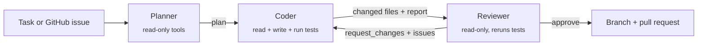

# devcrew

A small team of Claude agents that takes a coding task (or a GitHub issue) and works through it the way a team would: a **planner** reads the code and writes a plan, a **coder** carries it out, and a **reviewer** checks the result and sends it back if it's wrong. It comes with a **benchmark** that measures whether this setup actually does better than a single agent, and what it costs.



## Why this exists

Most "AI agent" demos stop once the agent has produced some output. This project tries to answer the more useful questions:

- **Does the structure help?** The benchmark runs the same tasks with a single agent (`solo`) and with the crew (`crew`), across models, and grades both against **hidden tests** the agents never see.
- **Can you trust "done"?** Every run records whether the agent *said* it succeeded and whether it *actually* passed. The gap between those two numbers is the thing to watch.
- **Is it cheating?** The grader hashes the visible tests before the run and fails any run that edited them, which catches the classic failure where an agent "fixes" a red test by weakening it.

## Design decisions

| Decision | Why |
|---|---|
| **Hand-written agent loop** ([`agent.py`](src/devcrew/agent.py)) instead of a framework | Every API detail is visible and tested: stop reasons (`tool_use`, `end_turn`, `max_tokens`, `pause_turn`, `refusal`), parallel tool calls answered in one message, thinking blocks passed back unchanged. |
| **Agents finish by calling a `submit_*` tool** | The tool's JSON schema (with `strict: true`) gives you a validated, structured result (plan, verdict, report) without having to parse free text. If an agent stops without submitting, the loop nudges it twice and then fails loudly. |
| **Least-privilege tools per role** | The planner and reviewer get no write tools, so a bad plan or a lenient review can't change the code. |
| **Fresh context per agent, explicit hand-offs** | Each agent sees only the task, the plan and the latest review. Prompts stay small, every hand-off can be inspected in the trace, and one agent's confusion doesn't carry over into the next. |
| **Guardrailed workspace** ([`tools.py`](src/devcrew/tools.py)) | Paths are confined to the repo. Commands run without a shell and only from an allowlist (`git` is limited to read-only subcommands), so `ls; rm -rf /` can't chain. This is a guardrail, not a sandbox. Run untrusted tasks in a container. |
| **Cost-aware by default** | Prompt caching on the stable system prompt and tool list, per-role `effort` (the reviewer runs at `medium`), per-role model choice, and per-role token and dollar accounting. |
| **Refusal fallbacks** | On the Opus and Sonnet models, a safety-classifier refusal is retried server-side on a fallback model, so a long run doesn't die halfway through. |
| **Offline test suite** | A scripted fake of the Messages API ([`tests/fakes.py`](tests/fakes.py)) covers the loop, the pipeline and the grader. CI needs no API key and costs nothing. |

## Quick start

```bash
pip install -e ".[dev]"
export ANTHROPIC_API_KEY=...        # or: ant auth login

# Run the crew on any repo
devcrew run "Add a --verbose flag to the CLI" --repo path/to/repo --trace traces/run.jsonl

# Work straight from a GitHub issue and open a PR if the reviewer approves (needs gh)
devcrew run --repo path/to/repo --issue 42 --open-pr

# Single-agent baseline for comparison
devcrew run "..." --mode solo
```

`--trace` writes every tool call, message and hand-off as JSONL, so you can replay exactly what each agent did.

## Benchmark

Six small, realistic tasks live in [`evals/tasks/`](evals/tasks). They cover bug fixes, a feature, an implementation from a stub, a parser, and a change that spans two files. Each task has a few visible tests plus held-out tests for edge cases the task description implies but doesn't spell out.

```bash
devcrew eval                                   # all setups, all tasks
devcrew eval --setups solo-opus,crew-opus --repeats 3
```

Results are written to `evals/results/<timestamp>.{json,md}`:

| Column | Meaning |
|---|---|
| Pass rate | All hidden and visible tests pass, and the visible tests are untouched |
| Said done | The run reported success (reviewer approved, or the solo agent claimed its tests passed) |
| Test tampering | Runs that edited the visible tests |
| Mean cost / time | Per task, from API usage |

### Results

_Not run yet. Results from `devcrew eval --repeats 3` will go here._

## Project layout

```
src/devcrew/
  llm.py       model settings, caching, fallbacks, cost accounting
  tools.py     workspace tools and JSON schemas
  agent.py     the agent loop
  roles.py     role prompts
  pipeline.py  planner -> coder -> reviewer orchestration, solo baseline
  evals.py     benchmark harness and grader
  cli.py       `devcrew run` / `devcrew eval`
evals/tasks/   benchmark tasks (task.md, repo/, hidden/)
tests/         offline unit tests with a scripted API fake
```

## Roadmap

- Run the benchmark and publish the numbers, then a cost-vs-pass-rate chart
- Mixed-model crews (an Opus planner and reviewer with a cheaper coder)
- Harder multi-file tasks taken from real open-source issues
- Run each task in a container for real isolation

## License

MIT
